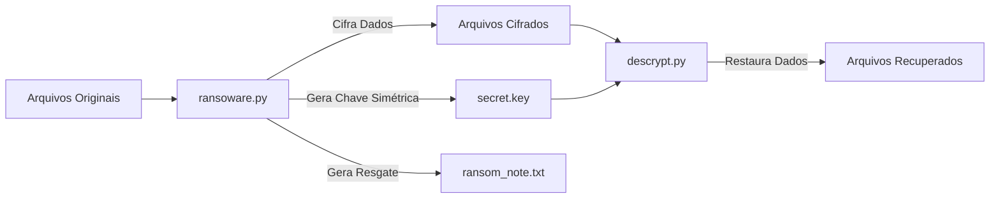
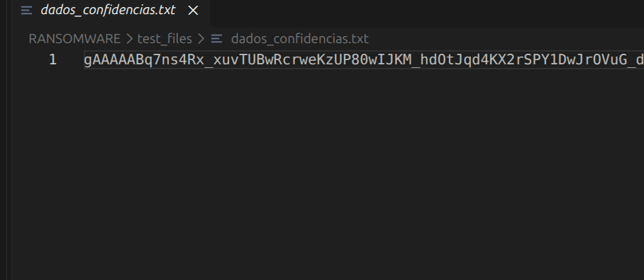
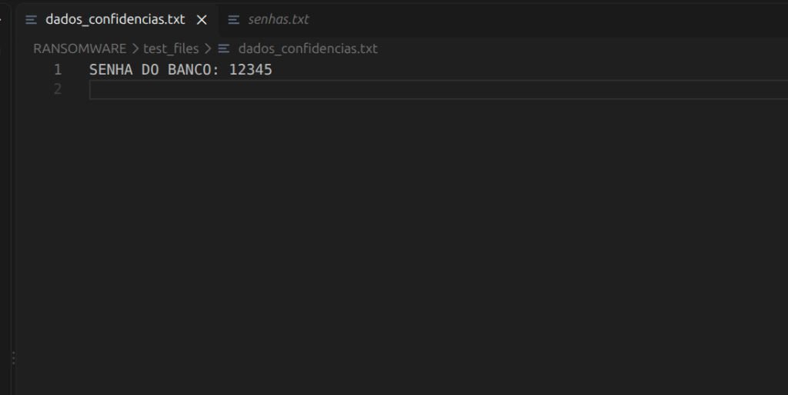
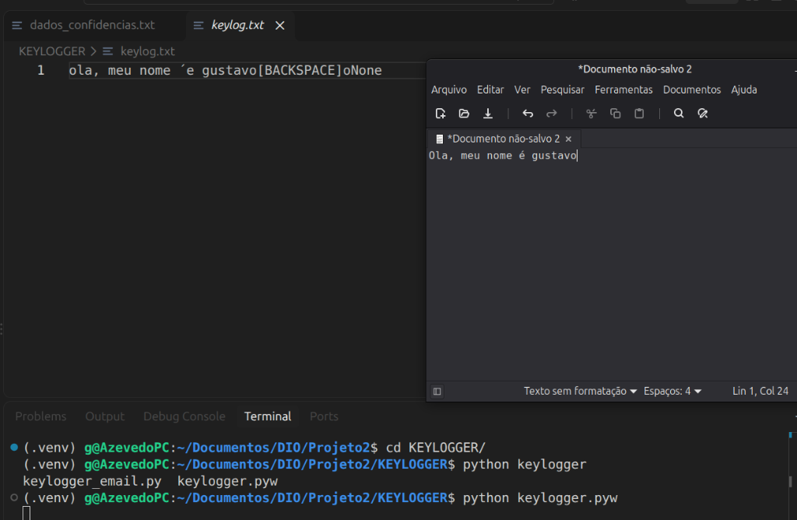
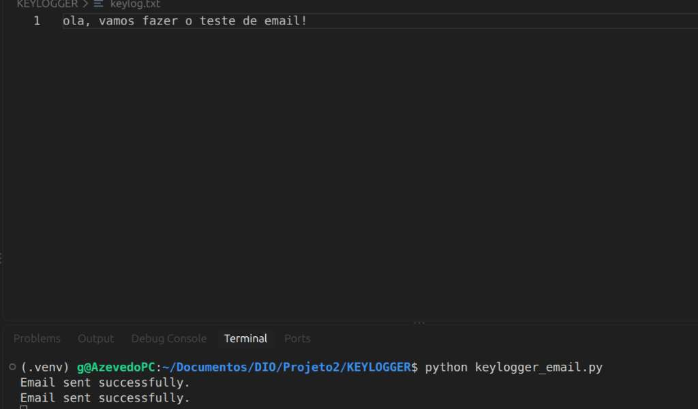
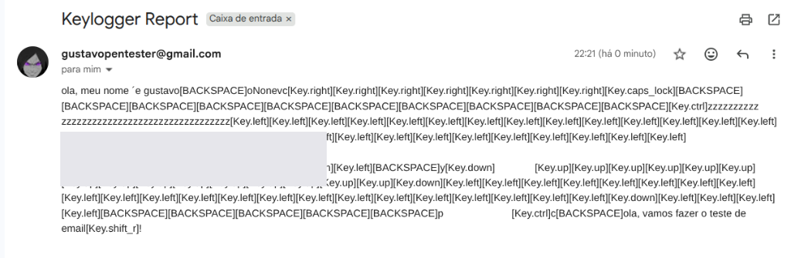

<p align="center">
  
</p>

<h1 align="center">Simulação de Malwares em Python: Ransomware e Keylogger</h1>

<p align="center">
  
  
  
  
</p>

---

## ⚠️ Disclaimer e Aviso Legal de Ética

> **ATENÇÃO:** O código e as informações deste repositório foram desenvolvidos exclusivamente para **fins educacionais e didáticos**, como parte do bootcamp de Cibersegurança da **[DIO (Digital Innovation One)](https://www.dio.me/)**.
>
> O objetivo é compreender o funcionamento interno e os mecanismos de infecção desses malwares para aprimorar técnicas de **defesa, mitigação e conscientização em cibersegurança**. Qualquer execução em ambientes não autorizados ou sem consentimento prévio é estritamente proibida e viola normas éticas e legais.

---

## 🎯 Sobre o Desafio

O projeto tem como foco o estudo prático e a análise comportamental de duas das maiores categorias de ameaças digitais modernas:

1. **Ransomware:** Compreender como malwares realizam a varredura do sistema, sequestro de dados via criptografia simétrica e exibição de notas de resgate (*ransom note*), além da implementação do processo de recuperação (descriptografia).
2. **Keylogger:** Analisar a captura de dados sensíveis digitados pelo usuário (inputs do teclado), técnicas básicas de persistência/furtividade e envio automático dos logs para um servidor remoto (exfiltração periódica via e-mail SMTP/TLS).
3. **Mecanismos de Defesa:** Avaliar os vetores de ataque explorados e documentar contramedidas eficazes para detecção e mitigação no mundo real.

---

## 📁 Estrutura do Repositório

```plaintext
Projeto2/
│
├── KEYLOGGER/
│   ├── .venv/                     # Ambiente virtual isolado (Python 3.12)
│   ├── keylogger.pyw              # Versão inicial do keylogger (captura local)
│   ├── keylogger_email.py         # Keylogger com exfiltração automática via SMTP/TLS
│   └── keylog.txt                 # Arquivo de log gerado com as teclas capturadas
│
├── RANSOWARE/
│   ├── test_files/                # Diretório controlado contendo arquivos de teste
│   ├── ransoware.py               # Script de cifragem recursiva e criação da nota
│   ├── descrypt.py                # Script de restauração e decifragem dos arquivos
│   ├── ransom_note.txt            # Mensagem de resgate gerada após a infecção
│   └── secret.key                 # Chave simétrica gerada dinamicamente (Fernet)
│
├── images/                        # Evidências e capturas de tela dos testes práticos
│   ├── ransomware_criptografado.png
│   ├── ransomware_descriptografado.png
│   ├── keylogger_captura_local.png
│   ├── keylogger_email_execucao.png
│   └── keylogger_email_recebido.png
│
└── README.md                      # Documentação completa do projeto
```

---

## 🔬 Análise Técnica das Implementações

### 1. Módulo: Ransomware Simulado (`/RANSOWARE`)

O módulo simula um ataque típico de sequestro de dados utilizando **criptografia simétrica**:

- **Biblioteca utilizada:** `cryptography.fernet` (combina AES-128 em modo CBC com HMAC para autenticação).
- **Mecanismos implementados:**
  - `generate_key()` / `load_key()`: Gera dinamicamente uma chave criptográfica segura e armazena em `secret.key`.
  - `search_files()`: Realiza uma varredura recursiva com `os.walk()` procurando arquivos alvos (extensões específicas, ex: `.txt`) na pasta `test_files/`.
  - `encrypt_file()`: Lê os bytes brutos do arquivo original, substitui pelo conteúdo cifrado e sobrescreve o arquivo no disco.
  - `display_message()`: Gera o arquivo `ransom_note.txt` contendo as instruções simuladas de pagamento de resgate.
  - **Descriptografia (`descrypt.py`):** Utiliza a chave gerada para reverter o arquivo ao seu estado original intacto.



#### 📸 Evidências Práticas do Ransomware:

<table align="center">
  <tr>
    <th align="center">1. Arquivo Criptografado (Ilegível)</th>
    <th align="center">2. Arquivo Restaurado com Sucesso</th>
  </tr>
  <tr>
    <td align="center">
      
      <br/>
      <em>Conteúdo transformado em token criptografado ilegível pelo ransoware.py</em>
    </td>
    <td align="center">
      
      <br/>
      <em>Conteúdo restaurado com sucesso após rodar o descrypt.py</em>
    </td>
  </tr>
</table>

---

### 2. Módulo: Keylogger Simulado (`/KEYLOGGER`)

O módulo demonstra como invasores capturam credenciais e segredos através do monitoramento de eventos de baixo nível de entrada:

- **Bibliotecas utilizadas:** `pynput.keyboard`, `smtplib`, `email.mime.text`, `threading.Timer`.
- **Mecanismos implementados:**
  - **Filtragem e Normalização:** O listener ignora teclas modificadoras não alfanuméricas puras (`Ctrl`, `Alt`, `Shift`, `Caps Lock`) e mapeia teclas especiais como `Enter`, `Tab`, `Space` e `[BACKSPACE]`.
  - **Furtividade de Janela:** Extensão `.pyw` (e execução desacoplada em background com `nohup`/`&` no Linux).
  - **Exfiltração Periódica (`keylogger_email.py`):**
    - Um timer assíncrono (`threading.Timer`) agenda envios periódicos em ciclos de **60 segundos** (1 minuto).
    - O conteúdo capturado em `keylog.txt` é encapsulado em uma mensagem MIME.
    - Conecta-se de forma segura aos servidores SMTP da Google via `smtp.gmail.com:587` utilizando `STARTTLS` e autenticação com senha de aplicativo.

#### 📸 Evidências Práticas do Keylogger:

<div align="center">
  <h4>1. Captura Local de Teclas em Tempo Real (`keylog.txt`)</h4>
  
  <p><em>Demonstração do keylogger interceptando digitação e tratando eventos como [BACKSPACE]</em></p>
  
  <br/>
  
  <h4>2. Execução da Exfiltração Contínua via SMTP</h4>
  
  <p><em>Script confirmando o envio automático com sucesso via terminal</em></p>
  
  <br/>
  
  <h4>3. E-mail de Relatório Recebido na Caixa de Entrada</h4>
  
  <p><em>Exfiltração de dados recebida com sucesso via Gmail (endereço ocultado por privacidade)</em></p>
</div>

---

## 🚀 Como Executar em Ambiente Controlado

### Pré-requisitos
- Sistema operacional Linux (testado em **Linux Mint / Ubuntu 24.04**).
- Python 3.12+ com módulo `venv` instalado:
  ```bash
  sudo apt update && sudo apt install -y python3-venv python3-full
  ```

### 1. Testando o Ransomware
```bash
# 1. Navegue até a pasta do ransomware
cd RANSOWARE

# 2. Crie e ative um ambiente virtual
python3 -m venv .venv
source .venv/bin/activate

# 3. Instale a biblioteca de criptografia
pip install cryptography

# 4. Execute o ransomware para criptografar a pasta test_files
python ransoware.py

# 5. Para reverter e restaurar os arquivos
python descrypt.py
```

### 2. Testando o Keylogger
```bash
# 1. Navegue até a pasta do keylogger
cd KEYLOGGER

# 2. Ative o ambiente virtual configurado
source .venv/bin/activate

# 3. Instale a biblioteca de captura de eventos
pip install pynput

# 4. Executar versão básica (captura local)
python keylogger.pyw

# 5. Executar versão com exfiltração contínua (a cada 60s)
python keylogger_email.py
```

---

## 🛡️ Estratégias de Defesa e Prevenção (Blue Team)

Com base nas vulnerabilidades e comportamentos analisados durante a construção dos scripts, as seguintes contramedidas devem ser implementadas no ambiente corporativo e pessoal:

| Vetor de Ataque | Ameaça Analisada | Contramedida / Defesa Recomendada |
| :--- | :--- | :--- |
| **Cifragem em Massa** | Ransomware alterando extensões de arquivos em diretórios locais. | **Estratégia de Backup 3-2-1** (3 cópias, 2 mídias diferentes, 1 imutável/offline); Soluções EDR com detecção de taxas anômalas de I/O em disco. |
| **Interceptação de Inputs** | Keylogger monitorando chamadas de API do sistema de teclado. | **MFA / 2FA Baseado em App/FIDO2** (chaves físicas ou OTP onde a senha digitada sozinha não concede acesso); Antivírus comportamental e proteção de memória. |
| **Exfiltração de Dados** | Conexões SMTP saindo para servidores externos na porta 587. | **Firewall e Filtragem de Tráfego de Saída (Egress Filtering)**: Bloquear conexões de portas SMTP comuns para executáveis não autorizados; Monitoramento de tráfego de rede (SIEM / DLP). |
| **Vetor de Entrada Inicial** | Engenharia social (phishing, anexos maliciosos, downloads não verificados). | **Conscientização de Usuários (Security Awareness)**, controle de privilégios mínimos (**Principle of Least Privilege**) e restrição de execução via AppLocker / Software Restriction Policies. |

---

## 🎓 Conclusão e Aprendizados

A implementação prática deste laboratório permitiu:
- Compreender a simplicidade técnica por trás de ameaças devastadoras quando executadas sem o devido isolamento e privilégios restritos.
- Constatar a importância de camadas de segurança em profundidade (**Defense in Depth**), onde a segurança não depende de um único mecanismo, mas da combinação de controle de privilégios, backup isolado, autenticação multifator e monitoramento ativo de tráfego.

---

<p align="center">
Desenvolvido por <b>Gustavo Azevedo</b> durante a formação de Cibersegurança na <b>DIO</b> 🚀
</p>
